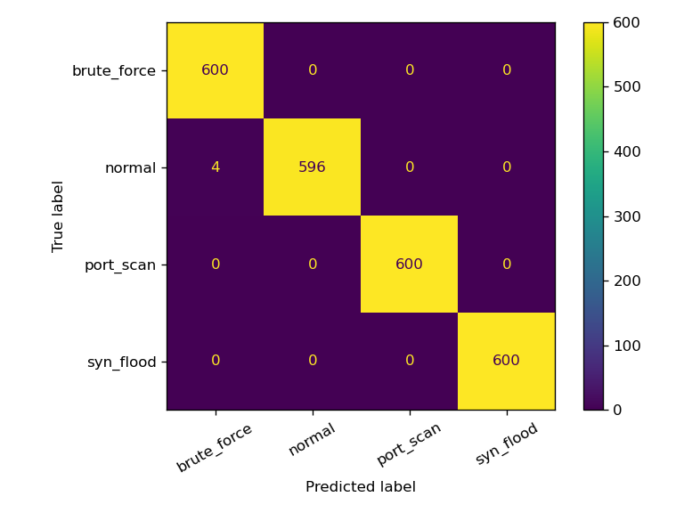
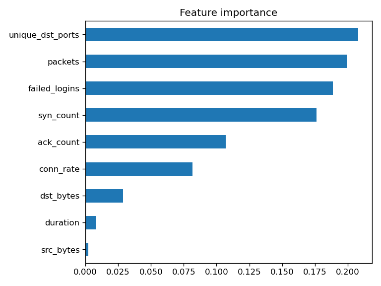

# AI-Powered Network Intrusion Detection System

Machine learning system that detects malicious network traffic (port scans, SYN floods, brute-force logins) from flow-level features.

## Approach
- **Random Forest (supervised):** classifies each flow as normal, port_scan, syn_flood or brute_force.
- **Isolation Forest (unsupervised):** trained on normal traffic only, so it can flag unknown (zero-day style) behaviour.
- Evaluation: 5-fold cross-validation, precision/recall/F1, confusion matrix, feature importance.
- Trained models saved with joblib for deployment.

## Results (simulated data, 9,600 flows)
- Random Forest: 99.8% accuracy, macro-F1 0.998 on a held-out test set
- Isolation Forest: 99.2% attack recall, 1.8% false alarm rate, no attack labels used

## Run
    pip install -r requirements.txt
    python network_ids.py

## Limitations
- Data is simulated, so real-world scores would be lower. Next step: retrain on NSL-KDD or CIC-IDS2017.
- Not yet connected to live packet capture (planned: Wireshark/tshark export -> features -> model).
